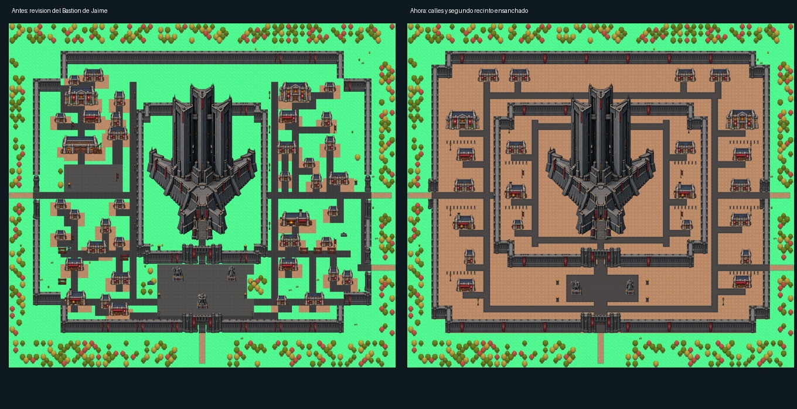
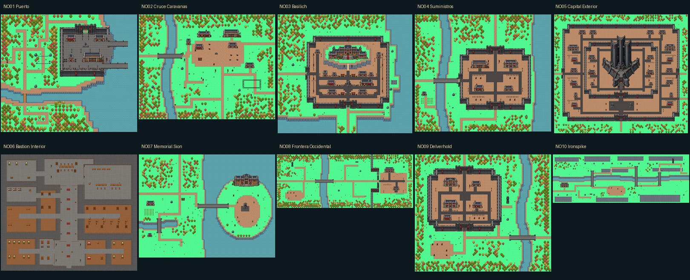

# Noxus — mapas Tiled y urbanismo imperial

Revisión basada en el Basilich manual de Jaime `17d230f` y en sus ajustes del Bastión. Las ciudades comparten suelo marrón, calles oscuras con bordillo, fachadas alineadas, murallas completas y decoración sobria. Caravanas y los recorridos rurales conservan sus caminos de tierra.

Abrir `public/assets/world/regions/Noxus/Noxus.world` en Tiled para ver las diez piezas. Cada mapa usa cuadrícula de 32 px y orden de capas authored. Los criterios concretos, índices locales de las calles, módulos de muralla y tratamiento del Bastión están en [urbanismo de Basilich](urbanismo-basilich.md).

NO01 conserva sus capas de tiles validadas por Jaime. NO03 conserva exactamente las capas visuales de su revisión manual `17d230f`; se corrigen únicamente las referencias del atlas ampliado y los objetos auxiliares de colisión y diseño que no se habían desplazado con los edificios y la decoración. El arte y la posición del Bastión aprobado también se verifican mediante un hash.

| Mapa | Tamaño (tiles) | Composición |
| --- | --- | --- |
| [NO01_Puerto](mapas/NO01_Puerto.jpg) | 74 × 64 | Puerto manual conservado; referencia de naturaleza, costas y ensamblajes. |
| [NO02_Cruce_Caravanas](mapas/NO02_Cruce_Caravanas.jpg) | 88 × 68 | Cruce rural de tierra, posada, mercado de tránsito, corral y puente. |
| [NO03_Basilich](mapas/NO03_Basilich.jpg) | 88 × 78 | Referencia visual manual de Jaime 17d230f conservada; huellas de edificios y decoración ajustadas a sus posiciones reales. |
| [NO04_Suministros](mapas/NO04_Suministros.jpg) | 88 × 76 | Suelo urbano marrón, ejes de servicio alineados, patio central, almacenes al norte, talleres al sur, vallas y farolas. |
| [NO05_Capital_Exterior](mapas/NO05_Capital_Exterior.jpg) | 112 × 100 | Segundo recinto de 62 tiles de ancho; 22 edificios de apoyo, archivo, armería y alojamiento dentro; circuito por ambos flancos y detrás de las torres. |
| [NO06_Bastion_Interior](mapas/NO06_Bastion_Interior.jpg) | 112 × 96 | Interior de 112 × 96 tiles: vestíbulo, galería, consejo, sala de guerra, biblioteca, archivo, armería y aposentos. |
| [NO07_Memorial_Sion](mapas/NO07_Memorial_Sion.jpg) | 100 × 76 | Islote redondo, tierra, hierba, templo y pedestal de Sion. |
| [NO08_Frontera_Occidental](mapas/NO08_Frontera_Occidental.jpg) | 132 × 52 | Valle horizontal y muralla quebrada; puesto urbano con calles de bordillo, tierra marrón y farolas. |
| [NO09_Delverhold](mapas/NO09_Delverhold.jpg) | 88 × 76 | Guarnición ordenada por manzanas: comandancia, barracones, forja, intendencia, patios y calles perimetrales. |
| [NO10_Ironspike](mapas/NO10_Ironspike.jpg) | 152 × 54 | Paso horizontal con terrazas, tres cruces del río, cantera y bocamina. |

## Capital y segundo recinto

El recinto del Bastión se ensancha de 38 a 62 tiles. Su muralla norte permanece por detrás de las torres, siguiendo el cambio de Jaime. Dos calles laterales se conectan por un paseo posterior y otro frente a la entrada: la altura visual de las torres no crea una pared invisible. La base física del edificio conserva sus colisiones y la entrada comunica con NO06.

Se redistribuyen casas exteriores para dejar espacio a la fortaleza. Dentro hay archivo, armería, taller, alojamiento de oficiales e intendencia. El eje ceremonial central tiene cuatro tiles; las calles locales mantienen dos. La forma exterior conserva sus retranqueos y sus entradas hacia las otras zonas.

## Fuentes y alcance

Fuentes en `public/assets/world/regions/Noxus/Zones`. `manifest.json` registra conexiones, objetivos y huellas protegidas. `Noxus_calles_32.tsx` declara las 60 celdas del atlas ampliado; permite usar sus nuevas esquinas sin desplazar los rangos históricos de los demás mapas. Los runtime se generan con `node scripts/prepare-tiled-maps.mjs` y no se versionan.

Los portales tienen destinos y retornos. El atajo puerto–Caravanas requiere `noxus:atajo-puerto-abierto`. NO06 es el interior del edificio. Los demás accesos de edificios se documentan para una fase de interiores; no apuntan a mapas inexistentes. Esta revisión prepara las fuentes y no activa la región ni despliega el juego publicado.

## Validación

- `python scripts/check-noxus-maps.py`: referencias, GID, fuentes/runtime, llegadas, conexiones, puntos de interés, escaleras y protección de NO01.
- `python scripts/check-noxus-urban-style.py`: protección de NO01 y del Basilich manual, atlas ampliado, esquinas de las calles, arte del Bastión y circuito continuo de dos tiles por sus flancos y parte posterior.
- WorldScene real: diez mapas renderizados; dos puentes y una escalera recorridos; Puerto–Basilich–Puerto y Capital–Bastión interior–Capital; circuito completo a pie por el flanco oeste, detrás de las torres, flanco este y frente del Bastión. Sin errores JavaScript.
- `npm run build`: compilación y comprobaciones generales correctas.

