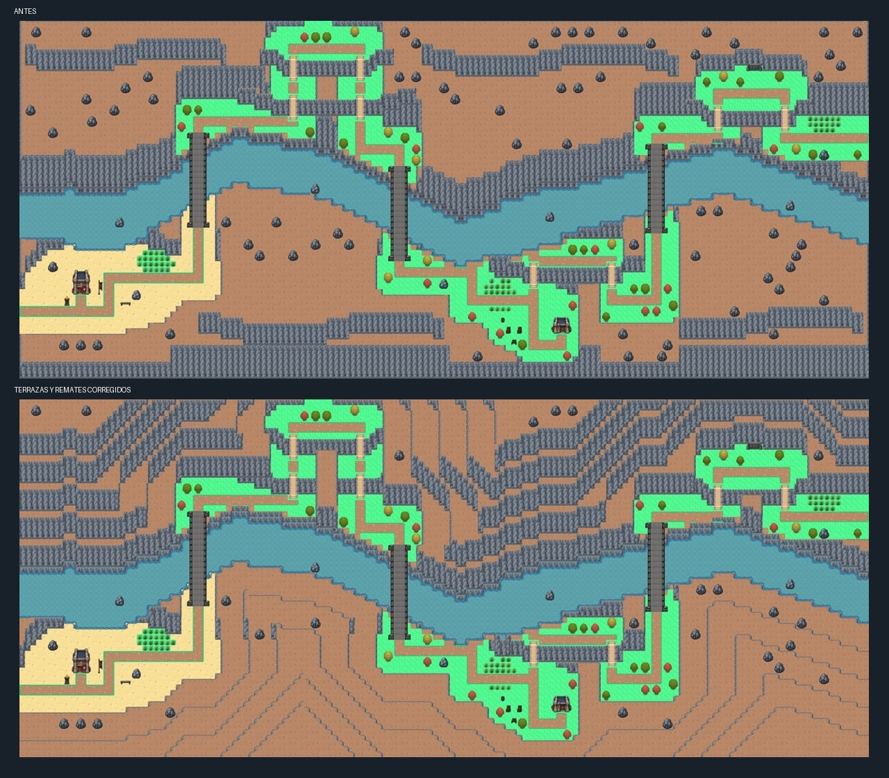

# Noxus — mapas Tiled y urbanismo imperial

Integración jugable sobre la última revisión manual de Jaime `fa34d65`. Los diez mapas se registran en el catálogo: nueve exteriores y el interior del Bastión. Se añaden tres santuarios completos de Soraka y una travesía de ida y vuelta entre el Islote del Reencuentro y el Puerto Oriental. Los seis mapas ajenos a esos servicios, incluido Ironspike, conservan sus archivos completos de la última subida.

Abrir `public/assets/world/regions/Noxus/Noxus.world` en Tiled para ver las diez piezas. Cada mapa usa cuadrícula de 32 px y orden de capas authored. Los criterios concretos, índices locales de las calles, módulos de muralla y tratamiento del Bastión están en [urbanismo de Basilich](urbanismo-basilich.md).

NO01 conserva sus capas de tiles validadas por Jaime. Basilich mantiene su composición urbana manual y añade el santuario junto a la puerta occidental, con un acceso de dos tiles. Los edificios y murallas no se desplazan. El arte y la posición del Bastión aprobado también se verifican mediante un hash.

| Mapa | Tamaño (tiles) | Composición |
| --- | --- | --- |
| [NO01_Puerto](mapas/NO01_Puerto.jpg) | 74 × 64 | Puerto manual conservado; sin hierba de apariciones. |
| [NO02_Cruce_Caravanas](mapas/NO02_Cruce_Caravanas.jpg) | 88 × 68 | Bosque que delimita las rutas, cinco claros de hierba, loma baja accesible, rocas, posada, mercado y corral conservado. |
| [NO03_Basilich](mapas/NO03_Basilich.jpg) | 88 × 78 | Referencia manual conservada; sin hierba de apariciones. |
| [NO04_Suministros](mapas/NO04_Suministros.jpg) | 88 × 76 | Recinto y agua corregidos por Jaime conservados; dos claros de hierba fuera de las murallas, al noroeste y cerca del puente. |
| [NO05_Capital_Exterior](mapas/NO05_Capital_Exterior.jpg) | 112 × 100 | Revisión manual de Jaime: capital con jardines, estanques y hierba alta; fuente conservada íntegramente. |
| [NO06_Bastion_Interior](mapas/NO06_Bastion_Interior.jpg) | 112 × 96 | Interior de 112 × 96 tiles: vestíbulo, galería, consejo, sala de guerra, biblioteca, archivo, armería y aposentos. |
| [NO07_Memorial_Sion](mapas/NO07_Memorial_Sion.jpg) | 100 × 76 | Isla conservada sin hierba alta nueva; continente arbolado con tres claros y desembocadura abierta al mar. |
| [NO08_Frontera_Occidental](mapas/NO08_Frontera_Occidental.jpg) | 132 × 52 | Bosque reforzado, terraza del mirador con escalera, dos lindes de salto hacia abajo y cinco claros de hierba. |
| [NO09_Delverhold](mapas/NO09_Delverhold.jpg) | 88 × 76 | Revisión manual de Jaime con más árboles y hierba; fuente conservada íntegramente. |
| [NO10_Ironspike](mapas/NO10_Ironspike.jpg) | 152 × 64 | Garganta sinuosa, tres puentes obligatorios, ocho escaleras, terrazas escalonadas, ribera de arena y grava, cantera y mirador. |

## Paso de Ironspike

Río serpenteante que obliga a cambiar de margen tres veces; macizos continuos cierran los extremos del paso. La ribera occidental tiene arena y grava, la travesía norte asciende por dos terrazas consecutivas y vuelve a bajar, la cantera ocupa un ensanche meridional y el mirador forma el último desnivel oriental. Los caminos, puentes y escaleras mantienen dos tiles transitables. Se reutilizan los recursos de roca oscura de Noxus.

Los macizos añaden hasta cuatro terrazas superiores encadenadas, sin abrir zonas transitables. El primer plano meridional usa bordes posteriores que continúan fuera del mapa, en lugar de terminar en una pared frontal. Se completan los giros interiores y exteriores de roca y las esquinas de costa con las piezas curvas del atlas. Solo se editan Obstacles y GroundDetails; el resto de las capas y los objetos de colisión conservan los datos aprobados.

## Capital y segundo recinto

La ciudad exterior tiene ahora cuatro áreas de funciones diferentes: Mercado de Hierro al oeste, distrito militar al este, zona cívica al norte y plaza ceremonial al sur. El mercado reúne cinco puestos, tiendas, mesas de mercancías, fuente, bancos y carga civil. La zona militar contiene cuartel, patio de instrucción, arsenal, forja, combustible y carros. La plaza de entrada se equipa con bancos, jardineras, braseros y bolardos alrededor de las estatuas.

El segundo recinto pasa de 62 a 52 tiles de ancho para ceder espacio a la ciudad. Se conservan cuatro dependencias pequeñas y un pavimento oscuro continuo. El paseo de dos tiles por ambos flancos y por detrás de las torres sigue accesible; la entrada comunica con NO06. El arte del Bastión, su posición y la superposición sobre la muralla norte se conservan.

El acceso ceremonial tiene cuatro tiles, las calles de distrito tres y los ramales de las puertas dos. El hueco real de los portones sigue siendo de dos tiles. La decoración se agrupa por funciones y las vallas utilizan los módulos horizontales completos de la referencia de Jaime.

## Fuentes y alcance

Fuentes en `public/assets/world/regions/Noxus/Zones`. `manifest.json` registra conexiones, objetivos y huellas protegidas. `Noxus_calles_32.tsx` declara las 60 celdas del atlas ampliado; permite usar sus nuevas esquinas sin desplazar los rangos históricos de los demás mapas. Los runtime se generan con `node scripts/prepare-tiled-maps.mjs` y no se versionan.

Los portales tienen destinos y retornos. El atajo puerto–Caravanas requiere `noxus:atajo-puerto-abierto`. NO06 es el interior del edificio. Los demás accesos de edificios se documentan para una fase de interiores; no apuntan a mapas inexistentes. La región está registrada para su publicación con esta integración. El resto de interiores, los NPC de historia, las misiones y las tablas de apariciones se desarrollarán sobre esta base.

## Naturaleza y hierba alta

Quince claros nuevos: cinco en Caravanas, dos en el exterior de Suministros, tres en el continente del Memorial y cinco en Frontera. El bosque delimita caminos y espacios de actividad, conservando cultivos y corrales. Se añaden dos elevaciones bajas con escaleras y dos lindes de salto hacia abajo. El río del Memorial conecta con el mar. Sus sombras y esquinas, junto con las de Caravanas y Frontera, siguen la referencia manual de Suministros.

Ver [criterios, alcance y validación de naturaleza](naturaleza-y-hierba.md). TallGrass queda preparado; las diez definiciones declaran `disableWildEncounters: true` hasta disponer de la fauna y progresión de Noxus. No se usa la tabla de Bandle por defecto.

## Validación actual

- `python scripts/check-noxus-maps.py`: diez mapas con navegación, referencias, llegadas, retornos, escaleras y objetivos accesibles. El índice externo recoge las posiciones actuales de tres entradas movidas en la capital.
- `python scripts/check-noxus-nature.py`: quince claros alcanzables, hierba fuera de los caminos y recintos, desembocadura continua, saltos con llegada libre, isla y recinto de Suministros protegidos. Hashes completos de Puerto, Basilich, capital, interior del Bastión, Delverhold sin cambios respecto a `0189c57`. Ironspike se interviene posteriormente con autorización y referencias nuevas.
- WorldScene real: lectura de TallGrass y desplazamiento dentro de la hierba de los cuatro mapas, dos escaleras nuevas, salto hacia abajo, bloqueo del ascenso por la linde y regreso por el camino lateral. Puentes y retornos existentes comprobados; sin errores JavaScript.
- `python scripts/check-noxus-ironspike.py`: recorrido completo, tres cruces obligatorios, ocho escaleras sin atajos, hierba accesible y hashes completos de los nueve mapas ajenos al encargo, actualizados a los retoques manuales `ec91c3e`. También comprueba el hash de toda la superficie bloqueada y de las capas conservadas de Ironspike.
- Ironspike en WorldScene real: travesía completa de oeste a este por 23 puntos de control, cruzando los tres puentes y las ocho escaleras; sin errores JavaScript. Esquinas interiores de tierra: 24 revisadas, sin errores.
- `npm run build`: compilación y comprobaciones generales correctas.

Los tests históricos de urbanismo y anchura se refieren a la distribución automática anterior. La esquina de calle (103, 71) y el circuito rectangular antiguo del Bastión requieren una revisión específica de la capital manual; quedan documentados y no se modifica el mapa para satisfacer aquellos invariantes.

La huella externa de la isla del Memorial y las coordenadas de las tres lindes de Frontera se actualizan a la revisión manual `ec91c3e`, que sustituye el snapshot anterior. Sus archivos Tiled no se modifican en esta intervención. El test de lindes exige ahora un paso alcanzable de dos tiles, con aproximación y aterrizaje libres, permitiendo que los extremos de una linde prolongada queden cerrados por árboles.

Revisión visual actual en WorldScene: cuatro encuadres y desplazamiento real por la entrada, un puente y una escalera, sin errores JavaScript. La huella de bloqueo completa y las capas conservadas de Ironspike coinciden con el trazado aprobado anterior. Compilación y validadores regionales correctos.

## Servicios y acceso jugable

| Mapa | Santuario | Entrada de dos tiles |
| --- | --- | --- |
| NO03 Basilich | Explanada junto a la puerta occidental; se conserva el recinto urbano | (384, 1168) px |
| NO05 Capital | Distrito occidental, próximo a la posada de la puerta sur | (832, 2480) px |
| NO09 Delverhold | Patio oriental de la guarnición | (1504, 976) px |

Reutilizan el santuario completo de Soraka de 8 × 7 tiles: copa en AbovePlayer, laterales sólidos y entrada central libre. Pulsar A/E restaura equipo y reserva, guarda el punto de recuperación y permite gestionar la reserva en su entorno. El puerto conserva todos sus tiles y recibe únicamente objetos de embarque y llegada.

El barco del Islote del Reencuentro ofrece Noxus al portar la runa de Jonia (`story:spirit-rune-carried`). El Puerto Oriental permite regresar siempre, sin una bandera adicional. No se alteran los barcos entre islas de Jonia ni sus retornos.

El atlas muestra nueve exteriores, respeta la numeración NO01–NO10 y sitúa el interior NO06 dentro de la capital NO05. Incluye las conexiones transitables y oculta el atajo Puerto–Caravanas hasta que se abra. El atlas consulta posiciones; no teletransporta.

Para continuar la historia: mantener los ID de `src/data/world/regions/noxus/zones/*/map.json`, las salidas y spawns existentes, y las reservas de DesignNotes. Los interiores adicionales no se generan todavía. `NO06_Bastion_Interior` sí está conectado a NO05. Definir encuentros de Noxus antes de activar la hierba alta; conservar Puerto y Basilich sin apariciones.

Validación de integración: `check-noxus-integration.mjs` se incorpora a prebuild; comprueba catálogo, atlas, dependencias, portales, barco de ida/vuelta, tres santuarios, curación del equipo y reserva, recuperación tras derrota y fuentes protegidas. WorldScene real: diez mapas renderizados sin inyectar definiciones de prueba, tres curaciones por interacción, reserva disponible, barco de ida/vuelta, entrada al Bastión y atlas de Noxus sin errores JavaScript. `check-noxus-maps.py`, `check-noxus-nature.py` y `check-noxus-ironspike.py` también pasan sobre las fuentes actuales.
