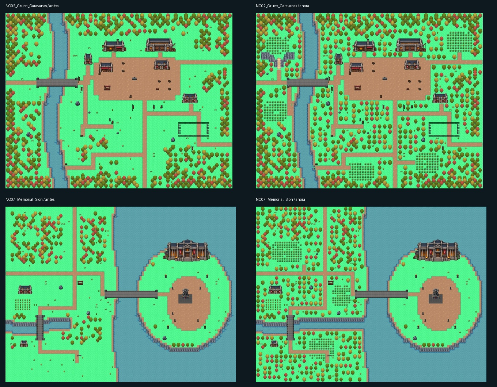

# Noxus — mapas Tiled y urbanismo imperial

Última intervención sobre la revisión manual de Jaime `0189c57`: bosques, claros de hierba, relieve y desembocadura. Se conserva la capital con sus nuevos estanques y jardines, Delverhold con su hierba manual e Ironspike sin cambios. La referencia urbana sigue siendo el Basilich manual `17d230f`. Las ciudades comparten suelo marrón, calles oscuras con bordillo, fachadas alineadas, murallas completas y decoración sobria. Caravanas y los recorridos rurales conservan sus caminos de tierra.

Abrir `public/assets/world/regions/Noxus/Noxus.world` en Tiled para ver las diez piezas. Cada mapa usa cuadrícula de 32 px y orden de capas authored. Los criterios concretos, índices locales de las calles, módulos de muralla y tratamiento del Bastión están en [urbanismo de Basilich](urbanismo-basilich.md).

NO01 conserva sus capas de tiles validadas por Jaime. NO03 conserva exactamente las capas visuales de su revisión manual `17d230f`; se corrigen únicamente las referencias del atlas ampliado y los objetos auxiliares de colisión y diseño que no se habían desplazado con los edificios y la decoración. El arte y la posición del Bastión aprobado también se verifican mediante un hash.

| Mapa | Tamaño (tiles) | Composición |
| --- | --- | --- |
| [NO01_Puerto](mapas/NO01_Puerto.jpg) | 74 × 64 | Puerto manual conservado; sin hierba de apariciones. |
| [NO02_Cruce_Caravanas](mapas/NO02_Cruce_Caravanas.jpg) | 88 × 68 | Bosque que delimita las rutas, cinco claros de hierba, loma baja accesible, rocas, posada, mercado y corral conservado. |
| [NO03_Basilich](mapas/NO03_Basilich.jpg) | 88 × 78 | Referencia manual conservada; sin hierba de apariciones. |
| [NO04_Suministros](mapas/NO04_Suministros.jpg) | 88 × 76 | Recinto y agua corregidos por Jaime conservados; dos claros de hierba fuera de las murallas, al noroeste y cerca del puente. |
| [NO05_Capital_Exterior](mapas/NO05_Capital_Exterior.jpg) | 112 × 100 | Revisión manual de Jaime: capital con jardines, estanques y hierba alta; fuente conservada íntegramente. |
| [NO06_Bastion_Interior](mapas/NO06_Bastion_Interior.jpg) | 112 × 96 | Interior de 112 × 96 tiles: vestíbulo, galería, consejo, sala de guerra, biblioteca, archivo, armería y aposentos. |
| [NO07_Memorial_Sion](mapas/NO07_Memorial_Sion.jpg) | 100 × 76 | Isla conservada sin hierba alta nueva; continente arbolado con tres claros y desembocadura abierta al mar. |
| [NO08_Frontera_Occidental](mapas/NO08_Frontera_Occidental.jpg) | 132 × 52 | Bosque reforzado, terraza del mirador con escalera, dos lindes de salto hacia abajo y cinco claros de hierba. |
| [NO09_Delverhold](mapas/NO09_Delverhold.jpg) | 88 × 76 | Revisión manual de Jaime con más árboles y hierba; fuente conservada íntegramente. |
| [NO10_Ironspike](mapas/NO10_Ironspike.jpg) | 152 × 54 | Sin cambios; pendiente de nueva referencia de desfiladero de Jaime. |

## Capital y segundo recinto

La ciudad exterior tiene ahora cuatro áreas de funciones diferentes: Mercado de Hierro al oeste, distrito militar al este, zona cívica al norte y plaza ceremonial al sur. El mercado reúne cinco puestos, tiendas, mesas de mercancías, fuente, bancos y carga civil. La zona militar contiene cuartel, patio de instrucción, arsenal, forja, combustible y carros. La plaza de entrada se equipa con bancos, jardineras, braseros y bolardos alrededor de las estatuas.

El segundo recinto pasa de 62 a 52 tiles de ancho para ceder espacio a la ciudad. Se conservan cuatro dependencias pequeñas y un pavimento oscuro continuo. El paseo de dos tiles por ambos flancos y por detrás de las torres sigue accesible; la entrada comunica con NO06. El arte del Bastión, su posición y la superposición sobre la muralla norte se conservan.

El acceso ceremonial tiene cuatro tiles, las calles de distrito tres y los ramales de las puertas dos. El hueco real de los portones sigue siendo de dos tiles. La decoración se agrupa por funciones y las vallas utilizan los módulos horizontales completos de la referencia de Jaime.

## Fuentes y alcance

Fuentes en `public/assets/world/regions/Noxus/Zones`. `manifest.json` registra conexiones, objetivos y huellas protegidas. `Noxus_calles_32.tsx` declara las 60 celdas del atlas ampliado; permite usar sus nuevas esquinas sin desplazar los rangos históricos de los demás mapas. Los runtime se generan con `node scripts/prepare-tiled-maps.mjs` y no se versionan.

Los portales tienen destinos y retornos. El atajo puerto–Caravanas requiere `noxus:atajo-puerto-abierto`. NO06 es el interior del edificio. Los demás accesos de edificios se documentan para una fase de interiores; no apuntan a mapas inexistentes. Esta revisión prepara las fuentes y no activa la región ni despliega el juego publicado.

## Naturaleza y hierba alta

Quince claros nuevos: cinco en Caravanas, dos en el exterior de Suministros, tres en el continente del Memorial y cinco en Frontera. El bosque delimita caminos y espacios de actividad, conservando cultivos y corrales. Se añaden dos elevaciones bajas con escaleras y dos lindes de salto hacia abajo. El río del Memorial conecta con el mar. Sus sombras y esquinas, junto con las de Caravanas y Frontera, siguen la referencia manual de Suministros.

Ver [criterios, alcance y validación de naturaleza](naturaleza-y-hierba.md). TallGrass queda preparado para las apariciones cuando se integre la región y su tabla de fauna; esta revisión no activa Noxus en la aventura publicada.

## Validación actual

- `python scripts/check-noxus-maps.py`: diez mapas con navegación, referencias, llegadas, retornos, escaleras y objetivos accesibles. El índice externo recoge las posiciones actuales de tres entradas movidas en la capital.
- `python scripts/check-noxus-nature.py`: quince claros alcanzables, hierba fuera de los caminos y recintos, desembocadura continua, saltos con llegada libre, isla y recinto de Suministros protegidos. Hashes completos de Puerto, Basilich, capital, interior del Bastión, Delverhold e Ironspike sin cambios respecto a `0189c57`.
- WorldScene real: lectura de TallGrass y desplazamiento dentro de la hierba de los cuatro mapas, dos escaleras nuevas, salto hacia abajo, bloqueo del ascenso por la linde y regreso por el camino lateral. Puentes y retornos existentes comprobados; sin errores JavaScript.
- `npm run build`: compilación y comprobaciones generales correctas.

Los tests históricos de urbanismo y anchura se refieren a la distribución automática anterior. La esquina de calle (103, 71) y el circuito rectangular antiguo del Bastión requieren una revisión específica de la capital manual; quedan documentados y no se modifica el mapa para satisfacer aquellos invariantes.

